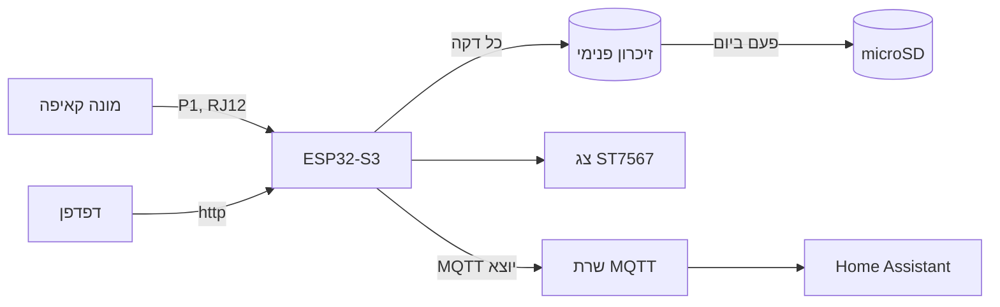

<div dir="rtl">

# P1 Logger

**לוגר לשנים למונים החכמים של חברת החשמל (קאיפה), על ESP32-S3.**

קורא את יציאת ה-P1 של המונה כל שנייה, שומר הכול בכרטיס microSD לשנים, מציג על צג, ומדווח ל-Home Assistant. הדיווח עובד גם מאתר מרוחק, בלי לפתוח פורטים.


[English](README.en.md) · **[⚡ התקנה מהדפדפן](https://amir684.github.io/kaifa-p1-logger-firmware/)** · [הורדות](../../releases)

</div>

---

## למה

המונה החכם משדר כל שנייה את כל מה שהוא מודד, אבל אף אחד לא שומר את זה. P1 Logger שומר הכול, לשנים, ועונה על שאלות כמו:

- **כמה עלה החשמל היום, לפי תעריף?** כל רגיסטר תעריף מתומחר בנפרד.
- **מתי בדיוק המתח צנח, ולכמה זמן?**
- **מה הייתה הצריכה בכל רבע שעה בחודש שעבר?** אלה הנתונים הרשמיים שהמונה עצמו מחשב.
- **האם המערכת הסולארית ייצאה היום, ובכל פאזה?**

## מה יש

| | |
|---|---|
| 🔌 **P1** | זיהוי אוטומטי של תצורת התקשורת ושל סוג המונה. CRC על כל מברק. מכיר את הקודים הישראליים (`1.8.11`–`1.8.13`, `96.14.1`). קוד לא מוכר נשמר ומתפרסם בכל זאת |
| ⏱️ **פרופיל עומס** | האנרגיה הרשמית של המונה לכל רבע שעה |
| 💾 **רישום** | שורה לכל דקה (ממוצע, מינימום, מקסימום) לתמיד. שורה לכל שנייה ל-60 יום. יומן אירועים. הקלטת מברקים גולמיים |
| 🛡️ **שורד תקלות כרטיס** | הדקות והאירועים נשמרים קודם בזיכרון הפנימי של הבקר, ומועתקים לכרטיס פעם ביום. כרטיס תקוע מקבל ניתוק מתח אוטומטי |
| ₪ **עלויות** | היום, אתמול, החודש ותחזית לסוף החודש. מע"מ, הנחה, תשלום קבוע, ייצוא |
| 📈 **גרפים** | יום שלם: הספק, פאזות, מתח, זרם ואנרגיה לפי שעה, עם רצועת מינימום ומקסימום, זום וסיכום יומי |
| 🏠 **Home Assistant** | MQTT Discovery: ישויות, התראות וכפתורים נוצרים לבד, לפי מה שהמונה שולח |
| 🚨 **התראות** | מתח גבוה או נמוך, צריכה גבוהה, אין נתונים, אין ייצוא סולארי, הפסקת חשמל, החלפת מונה |
| 📟 **צג** | ST7567 ‏128×64 או 96×48, ‏8 דפים בעברית או באנגלית, תפריט שלם מכפתור אחד |
| 🌈 **נורית מצב** | WS2812 שעל הלוח: הבהוב ירוק בכל מברק, אדום בתקלה, כחול במצב הגדרה |
| 🌐 **ממשק web** | כל ההגדרות, מברק חי, דפדפן קבצים, עדכון OTA, גיבוי ושחזור. בעברית ובאנגלית |
| 🔒 **WireGuard** | חיבור מאתר מרוחק (משק, מחסן) ל-Home Assistant בבית |
| 🔋 **UPS** | זיהוי הפסקת חשמל, כתיבה מסודרת לכרטיס, שינה כשהסוללה נגמרת |

## איך זה עובד



## התקנה

### 1. חומרה
אחד מהלוחות:

| לוח | קובץ |
|---|---|
| ‏ESP32-S3-DevKitC-1 **N16R8** | `p1logger-<גרסה>-full.bin` |
| ‏ESP32-S3 **N16R2** | `p1logger-<גרסה>-r2-full.bin` |
| ‏ESP32-S3 **Super Mini** (N4R2) | `p1logger-<גרסה>-mini-full.bin` |

ועוד: שקע RJ12 עם כבל 6 גידים, מודול microSD, ואם רוצים, צג ST7567. החיווט המלא ב-[docs/hardware.md](docs/hardware.md).

### 2. צריבה ראשונה
**הכי פשוט:** פותחים את **[דף ההתקנה](https://amir684.github.io/kaifa-p1-logger-firmware/)** ב-Chrome או ב-Edge במחשב, מחברים את הלוח ב-USB, בוחרים לוח ולוחצים "התקן". בלי להתקין שום דבר.

**או ידנית**, עם הקובץ `-full.bin` מ-[Releases](../../releases):
```bash
esptool.py --chip esp32s3 write_flash 0x0 p1logger-0.1.4-full.bin
```

### 3. הגדרה
1. **מתחברים:** בהפעלה הראשונה נפתחת רשת בשם `P1-Logger-xxxxxx`, עם הסיסמה `p1logger`. מתחברים מהטלפון, ודף ההגדרות נפתח לבד.
2. **רשת:** מוסיפים את רשת הבית. אם הנתב קרוב, מורידים את **עוצמת השידור** ל-11dBm.
3. **מערכת:** קובעים סיסמת מנהל ו**קידומת ישויות** (`home`, ‏`farm`).
4. **MQTT / HA:** כתובת השרת, ומסמנים "MQTT פעיל".
5. **תעריפים:** מחיר לקוט"ש.

**בלי מונה?** בלשונית **מונה** יש סימולטור: חד-פאזי, תלת-פאזי עם סולארי, או שידור חוזר של מברק אמיתי.

### 4. עדכונים
בממשק ה-web, בלשונית **מערכת**, מעלים את הקובץ `-ota.bin` מ-[Releases](../../releases). ההגדרות והנתונים נשמרים. אפשר גם מהמחשב:
```bash
curl -F "file=@p1logger-0.1.4-ota.bin" http://<ip>/api/ota
```

> ⚠️ דף ההתקנה ו-`-full.bin` מוחקים את כל הזיכרון של הלוח, כולל ההגדרות. לעדכון משתמשים רק ב-`-ota.bin`.

## חיווט בקצרה (DevKit)

| | ESP32-S3 |
|---|---|
| **P1 Data** (RJ12 פין 5) | GPIO39 + ‏1kΩ ל-3V3 |
| **P1 Request** (פין 2) | ‏1kΩ לפין 1 (‎+5V), **לא** ל-ESP |
| **SD** | CLK 12, ‏CMD 13, ‏D0 11, ‏D1 10, ‏D2 9, ‏D3 14 (או SPI: SCK 12, ‏MOSI 13, ‏MISO 11, ‏CS 14) |
| **צג** | SCK 5, ‏MOSI 6, ‏CS 7, ‏A0 15, ‏RST 16, תאורה 18 |

ב-Super Mini הפינים אחרים: [docs/hardware.md](docs/hardware.md#esp32-s3-super-mini).

> ⚠️ **ה-5V של המונה מוגבל ל-250mA.** ‏ESP32-S3 עם WiFi צריך יותר בשיאים. ראו [תקציב זרם](docs/hardware.md#תקציב-זרם).

## כפתור BOOT

כל הממשק על הלוח עובד מכפתור אחד:

| לחיצה | מה קורה |
|---|---|
| קצרה | הדף הבא. בתפריט: הפריט הבא |
| ‏1–3 שניות | פתיחת התפריט. בתוך התפריט: בחירה |
| ‏3 שניות | מצב הגדרה (רשת ההגדרה נפתחת) |
| ‏10 שניות | איפוס להגדרות יצרן |

במסך מופיע מה יקרה אם תשחרר, והנורית משנה צבע: לבן לתפריט, כחול למצב הגדרה, אדום מהבהב לאיפוס. לחצני ◀ ▶ OK על פינים 40–42 אופציונליים.

## הנורית

| צבע | מצב |
|---|---|
| 🟢 הבהוב קצר בכל שנייה | הכול תקין, מגיעים מברקים. טורקיז: המערכת מייצאת לרשת |
| 🔵 נשימה | מצב הגדרה |
| 🔵 הבהוב כל 3 שניות | אין חיבור ל-WiFi |
| 🟠 נשימה איטית | עובד מסוללה |
| 🔴 נשימה | אין נתונים מהמונה |
| 🔴 שני הבהובים | תקלה בכרטיס |
| 🔴 שלושה הבהובים | התראת מתח או הספק |

## המונים

| דגם | סוג | מצב |
|---|---|---|
| **MA110M** | חד-פאזי | ✅ **אומת** על מונה אמיתי. ‏16 קודים, כולם מוכרים |
| **MA309M** | תלת-פאזי, סולארי | ✅ **אומת** על שני מונים, צריכה וייצור |
| DSMR אחר | | 🟡 קודי DSMR כלליים מוכרים |

**כל הידוע על P1 במונים של חברת החשמל:** ‏[docs/p1-israel.md](docs/p1-israel.md). כולל CRC, פרופיל עומס, רזולוציה בפועל, ומה ייחודי לישראל.

**יש לכם מונה אחר?** מקליטים 10 דקות (לשונית **מונה** ← "הקלטת מברקים"), בודקים עם [tools/p1_check.py](tools/p1_check.py), ופותחים [Issue](../../issues/new/choose).

## תיעוד

| מסמך | |
|---|---|
| [docs/hardware.md](docs/hardware.md) | רכיבים, חיווט, UPS, תקציב זרם |
| [docs/p1-israel.md](docs/p1-israel.md) | הפרוטוקול במונים הישראליים |
| [docs/api.md](docs/api.md) | ‏REST, ‏MQTT, כל ההגדרות |
| [docs/troubleshooting.md](docs/troubleshooting.md) | תקלות ופתרונות |
| [docs/esp32-pitfalls.md](docs/esp32-pitfalls.md) | מלכודות ESP32-S3 שמצאנו בדרך |
| [homeassistant/](homeassistant/) | דשבורד ואוטומציות לדוגמה |
| [CHANGELOG.md](CHANGELOG.md) | היסטוריית גרסאות |

## קוד המקור

הקושחה מופצת כקבצים מוכנים בלבד. קוד המקור אינו פתוח. לשאלות, תקלות והצעות: [Issues](../../issues).

## קרדיט

נבנה על הידע מ-[klimofey/iec-p1-esphome](https://github.com/klimofey/iec-p1-esphome) ומ-[mp3llll/iec-p1-esphome-3phase](https://github.com/mp3llll/iec-p1-esphome-3phase). רישיונות של רכיבי צד שלישי: [THIRD_PARTY_NOTICES.md](THIRD_PARTY_NOTICES.md).

## רישיון

© 2026 amir684. מותר להוריד ולהשתמש בקושחה במכשירים שלכם, לשימוש אישי. אסור להפיץ מחדש, למכור או לשלב במוצר בלי אישור בכתב. פרטים ב-[LICENSE](LICENSE).
